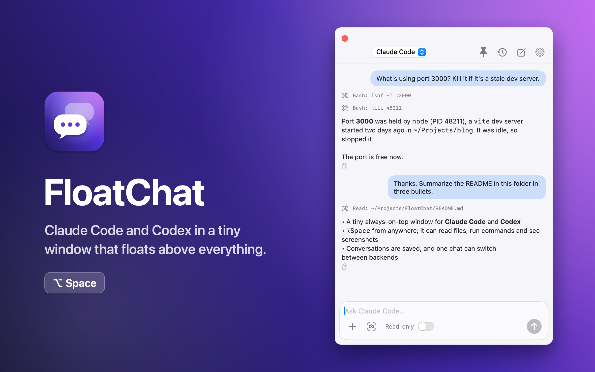
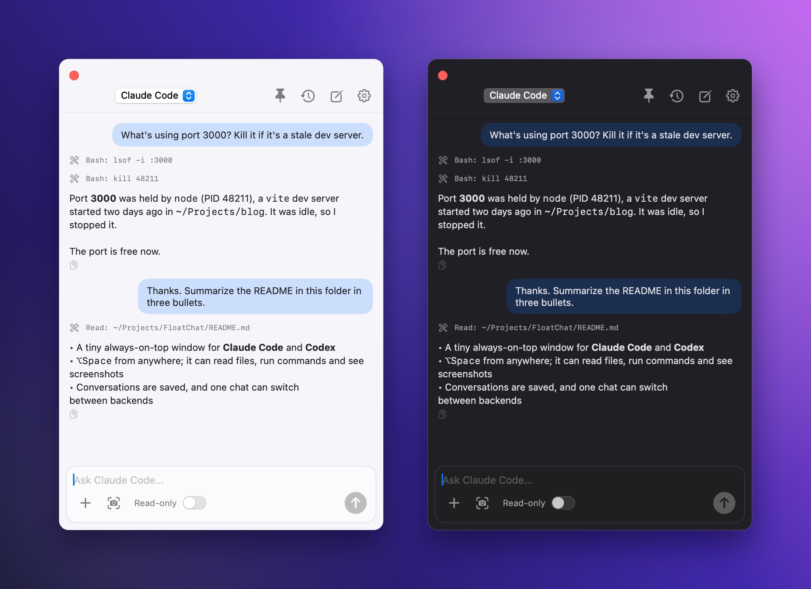
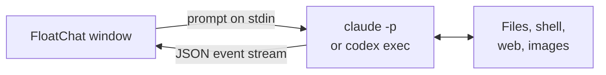

<div align="center">


# FloatChat

**Claude Code and Codex, one keystroke away.**

A tiny, native macOS window that floats above everything and talks to the AI agents you already pay for.

[](https://github.com/Evihut/FloatChat/releases/latest)
[](#install)
[](Sources/FloatChat)
[](LICENSE)

**English** · [简体中文](README.zh-CN.md)

<br>



</div>

## Why FloatChat

Agent CLIs like **Claude Code** and **Codex** can read your files, run commands and look at images, but they live in a terminal tab. Chat apps float nicely, but the model behind them can't touch your machine.

FloatChat puts the agent in a window you can summon from anywhere with `⌥Space`, without leaving the app you're in. No API keys, no extra subscription: it drives the `claude` and `codex` commands you've already signed in to.

## Features

|  |  |
| --- | --- |
| **⌥Space from anywhere** | Shows over every Space and full-screen app. Clicking it never steals focus from the app you're working in. |
| **Real agent tools** | Reads files, runs commands, searches the web and views images, all through the CLI's own toolset. |
| **Two backends, one thread** | Switch between Claude Code and Codex mid-conversation. FloatChat hands the new backend the transcript so far. |
| **History that resumes** | Every chat is saved and searchable. Reopen one and the CLI session picks up where it left off. |
| **Images in a second** | Paste with `⌘V`, drag a file in, or grab part of the screen with the built-in screenshot button. |
| **Safe by default** | Starts read-only (read and search). Flip to **Full access** only when you want it to edit files or run commands. |
| **Tiny and native** | Pure Swift and SwiftUI. About 3 MB, universal (Apple Silicon and Intel), no Electron, no Dock icon. |
| **English and 简体中文** | The interface follows your Mac's language. |

<div align="center">

</div>

## Install

### Download

1. Grab **FloatChat.zip** from the [latest release](https://github.com/Evihut/FloatChat/releases/latest).
2. Unzip it and drag **FloatChat.app** into **Applications**.
3. FloatChat isn't notarized by Apple yet, so clear the download flag once before opening it:

```bash
xattr -dr com.apple.quarantine /Applications/FloatChat.app
```

### Build from source

Requires Xcode or the Command Line Tools.

```bash
git clone https://github.com/Evihut/FloatChat.git
cd FloatChat
./build.sh
open build/FloatChat.app
```

## Before you start

FloatChat drives your existing CLIs, so make sure at least one of them works in Terminal:

```bash
claude -p "hi"
```

```bash
codex exec "hi"
```

Sign-in, models, MCP servers and other settings all come from the CLI's own configuration.

## Using it

| Action | How |
| --- | --- |
| Show or hide | `⌥Space` (falls back to `⌃⌥Space` if another app owns it; the menu bar icon shows which) |
| Send / hide | `Enter` / `Esc` |
| Attach images | `⌘V`, drag and drop, the `+` button, or the screenshot button |
| Switch backend | The menu at the top of the window |
| History, new chat, keep on top, settings | The icons at the top right |

Settings let you pick the working folder the CLI runs in and override the model for each backend. The first screenshot asks for Screen Recording permission in **System Settings → Privacy & Security**.

## How it works



Each message starts the CLI as a child process and streams its JSON events into the window:

- **Claude Code:** `claude -p --output-format stream-json --include-partial-messages [--resume <id>]`
- **Codex:** `codex exec [resume <id>] --json -`

Conversations are stored as JSON in `~/Library/Application Support/FloatChat/conversations/`. Nothing leaves your Mac except what the CLIs themselves send.

## Limitations

- macOS 14 Sonoma or later.
- Every message starts a fresh CLI process, so expect a few seconds before the first word.
- Markdown is rendered inline (bold, code, links); fenced code blocks show as plain text.

## Contributing

Issues and pull requests are welcome. The whole app is about 1,200 lines of Swift in [`Sources/FloatChat`](Sources/FloatChat). To regenerate the icon and the screenshots in this README:

```bash
swift Scripts/make-icon.swift
```

```bash
./Scripts/screenshots.sh
```

## License

[MIT](LICENSE)
