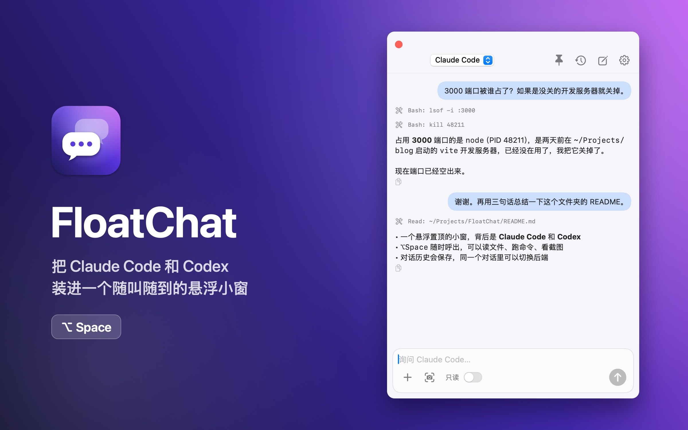
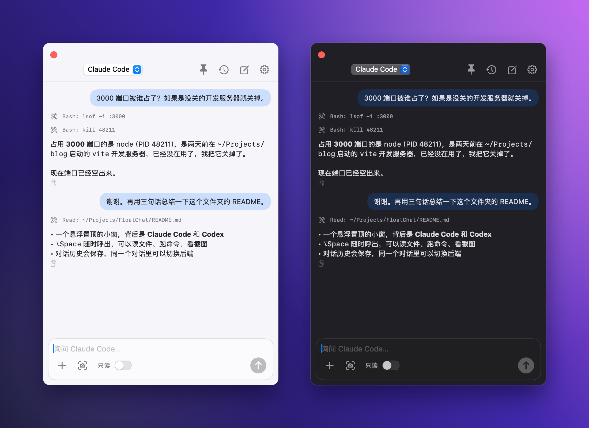
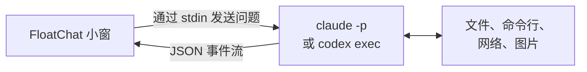

<div align="center">


# FloatChat

**一键呼出 Claude Code 和 Codex。**

一个原生的 macOS 悬浮小窗，浮在所有窗口之上，背后就是你已经在用的 AI agent。

[](https://github.com/Evihut/FloatChat/releases/latest)
[](#安装)
[](Sources/FloatChat)
[](LICENSE)

[English](README.md) · **简体中文**

<br>



</div>

## 为什么做 FloatChat

**Claude Code**、**Codex** 这类 agent 命令行能读文件、跑命令、看图片，但它们只能待在终端里。聊天 App 的小窗用起来很顺手，可背后的模型碰不到你的电脑。

FloatChat 把 agent 装进一个随时能呼出的小窗：在任何 App 里按 `⌥Space` 就能问，不用切走当前窗口。不需要 API Key，也不用另外付费，它直接调用你已经登录好的 `claude` 和 `codex` 命令。

## 功能

|  |  |
| --- | --- |
| **⌥Space 随时呼出** | 在所有桌面和全屏 App 上都能显示，点它也不会让你正在用的 App 失去焦点。 |
| **真正的 agent 工具** | 读文件、跑命令、联网搜索、看图片，用的都是 CLI 自带的工具。 |
| **两个后端，一个对话** | 对话中途可以在 Claude Code 和 Codex 之间切换，之前的聊天记录会自动交给新后端。 |
| **能接着聊的历史** | 每个对话都会保存，可以搜索。重新打开后，CLI 的会话也会接上。 |
| **秒传图片** | `⌘V` 粘贴、拖入文件，或者用自带的截图按钮框选屏幕。 |
| **默认安全** | 默认只读，只能读文件和搜索。只有打开"完全权限"，它才能改文件、执行命令。 |
| **小巧原生** | 纯 Swift 和 SwiftUI 编写，约 3 MB，同时支持 Apple Silicon 和 Intel，不用 Electron，不占 Dock。 |
| **中英双语** | 界面语言跟随系统设置。 |

<div align="center">

</div>

## 安装

### 直接下载

1. 从[最新版本](https://github.com/Evihut/FloatChat/releases/latest)下载 **FloatChat.zip**。
2. 解压后把 **FloatChat.app** 拖进"应用程序"。
3. FloatChat 暂时没有经过 Apple 公证，第一次打开前需要在终端运行一次：

```bash
xattr -dr com.apple.quarantine /Applications/FloatChat.app
```

### 从源码构建

需要 Xcode 或 Command Line Tools。

```bash
git clone https://github.com/Evihut/FloatChat.git
cd FloatChat
./build.sh
open build/FloatChat.app
```

## 开始之前

FloatChat 调用的是你本机的 CLI，所以先确认至少有一个能在终端里正常用：

```bash
claude -p "hi"
```

```bash
codex exec "hi"
```

登录、模型、MCP 服务器等设置，都沿用 CLI 自己的配置。

## 使用方法

| 操作 | 方式 |
| --- | --- |
| 呼出或隐藏 | `⌥Space`（被别的 App 占用时自动改用 `⌃⌥Space`，菜单栏图标里能看到当前用的是哪个） |
| 发送 / 隐藏 | `Enter` / `Esc` |
| 附加图片 | `⌘V`、拖入、`+` 按钮，或截图按钮 |
| 切换后端 | 窗口顶部的下拉菜单 |
| 历史、新对话、置顶、设置 | 右上角的图标 |

在设置里可以选择 CLI 运行的工作目录，也可以为每个后端单独指定模型。第一次截图时，需要在 **系统设置 → 隐私与安全性** 里允许录屏。

## 工作原理



每条消息都会启动一次 CLI 子进程，并把它输出的 JSON 事件实时显示在窗口里：

- **Claude Code：** `claude -p --output-format stream-json --include-partial-messages [--resume <id>]`
- **Codex：** `codex exec [resume <id>] --json -`

对话以 JSON 格式保存在 `~/Library/Application Support/FloatChat/conversations/`。除了 CLI 本身会发送的内容，没有任何数据离开你的 Mac。

## 局限

- 需要 macOS 14 Sonoma 或更新版本。
- 每条消息都要重新启动一次 CLI，第一个字出来前会等几秒。
- Markdown 只渲染行内格式（粗体、代码、链接），代码块按纯文本显示。

## 参与贡献

欢迎提 Issue 和 Pull Request。整个 App 只有 1200 行左右的 Swift 代码，都在 [`Sources/FloatChat`](Sources/FloatChat) 里。重新生成图标和本页截图：

```bash
swift Scripts/make-icon.swift
```

```bash
./Scripts/screenshots.sh
```

## 许可证

[MIT](LICENSE)
